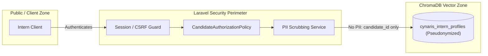

# W9D1 — Architecture Design: CIA Career Mode

**Project:** CIA Career Intelligence (`cynaris-portal`)
**Document Version:** 1.0.0 (Design & Architecture Phase)
**Author:** Sachidananda Nayak
**Status:** Architecture Proposal / Specification (Business logic not yet implemented)
**Date:** October 26, 2026

---

## 1. Executive Summary & Objective

The **CIA Career Mode** (Cynaris Career Intelligence) is an advanced subsystem designed for the Cynaris Portal. It bridges intern assessment data, structured skill progression, and job market demand through semantic intelligence.

By integrating candidate competency profiles with vector similarity matching, CIA Career Mode provides interns with actionable career readiness scores, automated competency gap analyses against live job benchmarks, and AI-curated role recommendations.

> [!IMPORTANT]
> **Architecture-Design Phase Notice:**
> This document specifies the architectural topology, service boundaries, controller responsibilities, and proposed route definitions for CIA Career Mode. In accordance with the W9D1 guidelines, **no business logic or active routes pointing to nonexistent controllers have been implemented**.

---

## 2. Seven Proposed CIA Career Mode Sub-Routes

All Career Mode sub-routes are designed to live in `routes/web.php`, organized under the `/career` prefix and secured by Laravel's standard authentication and verification middleware stack (`['auth', 'verified']`).

| # | Route Name | HTTP Method | URL Pattern | Middleware | Controller & Proposed Action | Purpose |
|---|---|---|---|---|---|---|
| 1 | `career.dashboard` | `GET` | `/career` | `['auth', 'verified']` | `CiaCareerController@index` | Main Career Intelligence cockpit: displays readiness score, active track status, and quick matches. |
| 2 | `career.profile.show` | `GET` | `/career/profile` | `['auth', 'verified']` | `CiaCareerController@profile` | Candidate skill matrix, assessment score breakdowns, and vector profile synchronization status. |
| 3 | `career.profile.sync` | `POST` | `/career/profile/sync` | `['auth', 'verified']` | `CiaCareerController@syncProfile` | Triggers background synchronization of intern skills, quiz scores, and history into ChromaDB. |
| 4 | `career.matches.index` | `GET` | `/career/matches` | `['auth', 'verified']` | `CiaCareerController@matches` | Semantic role and job matching powered by vector similarity search against open positions. |
| 5 | `career.gap-analysis` | `/career/gap-analysis` | `POST` | `['auth', 'verified']` | `CiaCareerController@gapAnalysis` | Computes competency delta between candidate profile and a benchmark job role profile. |
| 6 | `career.assessments.store`| `POST` | `/career/assessments` | `['auth', 'verified']` | `CiaCareerController@submitAssessment` | Ingests challenge/quiz performance data, updates longitudinal history, and queues vector refresh. |
| 7 | `career.report.export` | `GET` | `/career/report` | `['auth', 'verified']` | `CiaCareerController@exportReport` | Generates a structured, privacy-preserving Career Readiness Passport export (PDF/JSON). |

### Proposed `routes/web.php` Definition Block (Future Implementation)

The following block represents the exact syntax and grouping to be appended to [`laravel_basics/routes/web.php`](file:///c:/Users/sachin/Documents/Cynaris-Internship/laravel_basics/routes/web.php) once controller stubs and service dependencies are provisioned in subsequent development days:

```php
// ==========================================
// Week 9: CIA Career Mode Sub-Routes (PROPOSED / FUTURE IMPLEMENTATION)
// Do not activate until App\Http\Controllers\CiaCareerController is created.
// ==========================================
Route::prefix('career')->name('career.')->middleware(['auth', 'verified'])->group(function () {
    // 1. Career Mode Dashboard / Cockpit
    Route::get('/', [App\Http\Controllers\CiaCareerController::class, 'index'])->name('dashboard');

    // 2. Candidate Skill Matrix & Vector State
    Route::get('/profile', [App\Http\Controllers\CiaCareerController::class, 'profile'])->name('profile.show');

    // 3. Profile Vector Synchronization (ChromaDB cynaris_intern_profiles)
    Route::post('/profile/sync', [App\Http\Controllers\CiaCareerController::class, 'syncProfile'])->name('profile.sync');

    // 4. Semantic Job & Internship Role Matching
    Route::get('/matches', [App\Http\Controllers\CiaCareerController::class, 'matches'])->name('matches.index');

    // 5. Intelligent Competency Gap Analysis
    Route::post('/gap-analysis', [App\Http\Controllers\CiaCareerController::class, 'gapAnalysis'])->name('gap-analysis');

    // 6. Assessment Result Ingestion & Historical Score Progression
    Route::post('/assessments', [App\Http\Controllers\CiaCareerController::class, 'submitAssessment'])->name('assessments.store');

    // 7. Career Readiness Report / Passport Export
    Route::get('/report', [App\Http\Controllers\CiaCareerController::class, 'exportReport'])->name('report.export');
});
```

---

## 3. Architecture & Service Boundaries

The CIA Career Mode system is structured with strict separation of concerns across presentation, routing, application orchestration, domain services, persistence, and external vector storage.

```mermaid
flowchart TD
    subgraph ClientLayer["Frontend Client Layer"]
        UI["Web Browser (Blade / Tailwind / Alpine.js)"]
        UI_SPA["Dynamic Career Dashboard Components"]
    end

    subgraph LaravelBoundary["Laravel Application Boundary (cynaris-portal)"]
        subgraph RoutingMiddleware["HTTP & Security Layer"]
            Router["routes/web.php (/career/*)"]
            AuthMid["auth & verified Middleware"]
            CSRFMid["VerifyCsrfToken Middleware"]
        end

        subgraph ControllerLayer["Presentation Controllers"]
            CareerCtrl["CiaCareerController (App/Http/Controllers)"]
        end

        subgraph ServiceLayer["Domain & Integration Services"]
            CareerService["CareerIntelligenceService (App/Services)"]
            VectorClient["ChromaDbService (App/Services/Vector)"]
            JobMatchEngine["RoleMatchingEngine (App/Services/Matching)"]
        end

        subgraph QueueLayer["Asynchronous Queue System"]
            SyncJob["SyncCandidateVectorProfileJob (App/Jobs)"]
            QueueWorker["Laravel Queue Worker (database/redis)"]
        end

        subgraph RelationalDB["Relational Persistence (MySQL / SQLite)"]
            UsersTable[("users table")]
            CandidatesTable[("candidates / intern_profiles")]
            AssessmentsTable[("assessments table")]
            JobsTable[("jobs / job_postings table")]
        end
    end

    subgraph VectorDBBoundary["External Vector Intelligence Boundary"]
        ChromaHost["ChromaDB Service (REST API :8000)"]
        Collection[("Collection: cynaris_intern_profiles")]
        EmbedModel["Embedding Engine (e.g. all-MiniLM-L6-v2)"]
    end

    %% Client Interactions
    UI -->|Session Auth + CSRF| Router
    UI_SPA -->|Asynchronous Fetch| Router
    Router --> AuthMid
    AuthMid --> CSRFMid
    CSRFMid --> CareerCtrl

    %% Controller to Services
    CareerCtrl -->|Orchestrates requests| CareerService
    CareerService -->|Read/Write user state| CandidatesTable
    CareerService -->|Read assessment history| AssessmentsTable
    CareerService -->|Read active job specs| JobsTable
    CareerService -->|Dispatch async sync| SyncJob
    CareerService -->|Synchronous matching query| JobMatchEngine

    %% Queue to Chroma
    SyncJob -.-> QueueWorker
    QueueWorker -->|Vector upsert/delete| VectorClient
    JobMatchEngine -->|Similarity search query| VectorClient

    %% Service to External Vector DB
    VectorClient -->|HTTP REST Client (Guzzle/Http Facade)| ChromaHost
    ChromaHost --> EmbedModel
    ChromaHost --> Collection
```

---

## 4. Middleware & Authentication Architecture

1. **Authentication Guard (`auth`):**
   * Uses Laravel's default session-based `web` guard.
   * Interns access Career Mode through their authenticated browser session established via Laravel Breeze.
   * Unauthenticated requests are intercepted and redirected to `/login` with an intended destination callback.
2. **Email Verification Guard (`verified`):**
   * Ensures that candidate identity has been validated before vector computation, preventing spam or sybil profile creation in ChromaDB.
3. **Cross-Site Request Forgery (`CSRF`):**
   * All state-mutating requests (`POST /career/profile/sync`, `POST /career/gap-analysis`, `POST /career/assessments`) require a valid `X-CSRF-TOKEN` header or `_token` input.
4. **Candidate Authorization Policies:**
   * Interns are strictly scoped to their own `candidate_id` derived from `Auth::user()->candidate_id`.
   * Cross-tenant access is prohibited at the policy layer (`CandidatePolicy@view`, `CandidatePolicy@update`).

---

## 5. Controller Action Responsibilities

| Action Method | Primary Responsibility | Input Validation | Output Presentation |
|---|---|---|---|
| `index()` | Aggregates candidate summary, overall readiness index, and top 3 career track recommendations. | None (contextual to authenticated user). | Blade view `career.index` with pre-computed summary view models. |
| `profile()` | Retrieves the detailed competency matrix, skill category proficiencies, and recent assessment history. | None. | Blade view `career.profile` with granular skill and score charts. |
| `syncProfile()` | Reads relational candidate data, formats the vector document payload, and dispatches the vector sync job. | Rate limit check (max 1 sync per minute). | JSON / Session flash response indicating sync job dispatch status (`202 Accepted`). |
| `matches()` | Executes nearest-neighbor semantic search against job role vectors filtered by candidate preference. | Optional query filters (`domain`, `remote`, `min_score`). | Blade view / JSON collection of matched roles with similarity confidence percentages. |
| `gapAnalysis()` | Compares candidate vector profile with target role requirements; identifies competency deficits. | Valid `target_role_id` or `job_id` (integer/uuid). | JSON / View model detailing matched skills, missing skills, and recommended learning pathways. |
| `submitAssessment()` | Validates and stores assessment challenge scores in relational DB, appends to score history, and triggers vector refresh. | `challenge_id`, `score`, `skill_tags`, `time_taken_seconds`. | JSON status (`201 Created`) with updated composite readiness score. |
| `exportReport()` | Compiles an anonymized Career Readiness Passport containing verified skills, score percentiles, and gap analysis. | Format selector (`format=json` or `format=pdf`). | Streamed download or structured JSON payload with candidate PII sanitized. |

---

## 6. End-to-End Data Flow Scenarios

### Scenario A: Candidate Vector Profile Synchronization (`POST /career/profile/sync`)
1. **User Action:** Intern completes a technical quiz or clicks "Sync Career Profile" on their dashboard.
2. **Controller Interception:** `CiaCareerController@syncProfile` validates the authenticated user.
3. **Relational Aggregation:** `CareerIntelligenceService` compiles the candidate's verified skills, weighted assessment scores, and trajectory history from the relational database.
4. **Anonymization & Tokenization:** Personal identifers (name, email, phone) are scrubbed; the payload is keyed solely by `candidate_id`.
5. **Asynchronous Dispatch:** `SyncCandidateVectorProfileJob` is queued with the sanitized payload.
6. **ChromaDB Ingestion:** The background queue worker invokes `ChromaDbService::upsertProfile()`, generating dense embeddings and writing to `cynaris_intern_profiles`.
7. **Client Notification:** Web frontend receives an immediate `202 Accepted` response with a polling or event status token.

### Scenario B: AI Semantic Role Matching (`GET /career/matches`)
1. **User Action:** Candidate views the "Matched Opportunities" tab.
2. **Controller Query:** `CiaCareerController@matches` passes `candidate_id` and optional industry filters to `RoleMatchingEngine`.
3. **Vector Distance Query:** `ChromaDbService` retrieves the candidate's vector and performs a k-Nearest Neighbors ($k$-NN) cosine similarity query against the job description vectors.
4. **Metadata Filtering:** Results are filtered using ChromaDB `where` clauses (e.g., minimum score thresholds, domain compatibility).
5. **Relational Enrichment:** Job IDs returned by ChromaDB are hydrated with relational data (company name, salary range, application deadline) via Eloquent.
6. **Response Delivery:** Top matching roles with affinity percentages (e.g., "94% Match — Backend Laravel Specialist") are rendered to the user.

---

## 7. Security Boundaries & Privacy Constraints



1. **Zero PII in Vector Space:**
   ChromaDB documents and metadata must **never** contain candidate names, emails, addresses, phone numbers, or demographic data. Only pseudonymous `candidate_id` identifiers are stored in the vector database.
2. **Isolation from Public API:**
   The ChromaDB vector database is never exposed directly to the internet or the frontend. All vector interactions occur strictly through internal server-to-server calls from the Laravel service layer.
3. **Right to Be Forgotten Compliance:**
   When a user account is deleted or reset, Laravel issues a synchronous or transactional deletion event to ChromaDB:
   `$chromaService->deleteCandidateProfile($candidateId);`

---

## 8. Architectural Decision Records (ADR) Summary

| Decision | Chosen Approach | Rationale | Alternatives Considered |
|---|---|---|---|
| **Route Architecture** | Grouped web routes in `routes/web.php` with session auth. | Seamless integration with existing Laravel Breeze web portal and blade views. | Dedicated API routes in `routes/api.php` with Sanctum Bearer tokens (reserved for external mobile apps). |
| **Vector DB Boundary** | Isolated `ChromaDbService` HTTP wrapper. | Keeps Laravel models decoupled from vector store vendor lock-in. | Direct active-record embedding plugins or relational vector extensions (pgvector). |
| **Profile Sync Execution** | Asynchronous Laravel Queued Job. | Eliminates HTTP request latency during embedding generation and vector indexing. | Synchronous HTTP calls during controller request-response cycle. |
| **Route Activation State** | Documented proposal without active controller binds. | Adheres strictly to W9D1 architecture-design constraints; prevents runtime errors. | Creating empty controller stubs with dummy return values. |
