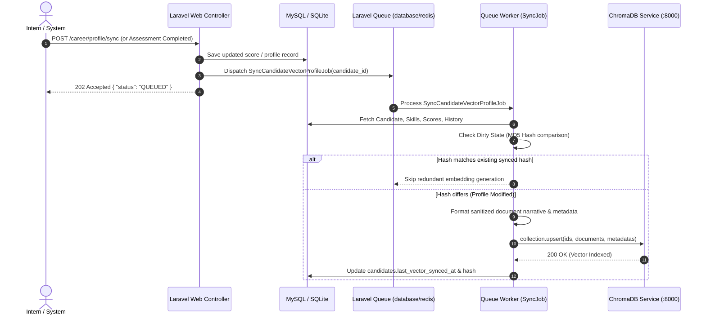

# W9D1 — ChromaDB Collection Specification: `cynaris_intern_profiles`

**Project:** CIA Career Intelligence (`cynaris-portal`)
**Specification Version:** 1.0.0 (Design & Architecture Phase)
**Status:** ARCHITECTURAL SPECIFICATION — NOT CURRENTLY INTEGRATED
**Author:** Sachidananda Nayak
**Date:** October 26, 2026

---

## 1. System Integration Notice

> [!IMPORTANT]
> **Architectural Status Disclaimer:**
> ChromaDB is **not currently installed, configured, or connected** in the `cynaris-portal` repository. No ChromaDB dependencies (`composer.json`), connection variables (`.env`), or active database migrations have been introduced during this W9D1 architecture-design phase.
>
> This document serves as the authoritative vector schema specification and integration design for upcoming implementation phases.

---

## 2. Target Collection Overview

* **Collection Name:** `cynaris_intern_profiles`
* **Purpose:** Stores dense semantic embeddings and structured metadata representing intern competencies, verified assessment performance, and learning trajectories for semantic role matching and gap analysis.
* **Vector Distance Metric:** Cosine Similarity (`"hnsw:space": "cosine"`)
* **Embedding Model Target:** `all-MiniLM-L6-v2` (384-dimensional dense vectors) or OpenAI `text-embedding-3-small` (1536 dimensions) via sentence-transformers / embedding microservice.
* **Collection Primary Key (`id`):** Pseudonymous `candidate_id` (e.g., `cand_01h8x9p3q1`).

---

## 3. Field Segmentation Matrix

The required data fields (`candidate_id`, `skills`, `scores`, `history`) are categorized into ChromaDB's three distinct data layers: **Document Text**, **Metadata**, and **Embeddings**.

| Field Name | Data Layer | Data Type | Purpose & Handling |
|---|---|---|---|
| `candidate_id` | **Collection ID (`id`) & Metadata** | String (UUID / Prefixed slug) | Primary unique identifier for the vector record. Stored as the ChromaDB document `id` and mirrored in metadata for exact equality filtering (`$eq`). |
| `skills` | **Document Text & Metadata** | Document: Text Narrative<br>Metadata: Comma-separated strings / Category counts | Document text contains a formatted semantic narrative of skills and proficiency levels for vector embedding. Metadata contains scalar indicators (e.g., `verified_skills_count`, `primary_domain`) for pre-filtering. |
| `scores` | **Metadata & Document Text** | Metadata: Float / Integer<br>Document: Score summary text | Numerical scores are stored as scalar floats in metadata (`composite_score`, `quiz_avg`, `capstone_score`) enabling relational range filters (`$gte`, `$lte`). Descriptive performance is embedded in document text. |
| `history` | **Document Text & Metadata** | Document: Longitudinal narrative<br>Metadata: Integer counter & ISO timestamps | Longitudinal progression, completed learning modules, and assessment tracks are structured as natural-language narrative in document text. Key milestones (`modules_completed_count`, `last_assessed_at`) reside in metadata. |
| **Embeddings** | **Vector Representation** | Array of Floats (`float32[]`) | High-dimensional dense representation automatically generated by the ChromaDB embedding function from `document` text, or computed by Laravel via external embedding API. |

---

## 4. Collection Payload & Schema Specification

When the Laravel service layer (`App\Services\Vector\ChromaDbService`) synchronizes a candidate, it formats and dispatches the following JSON payload to ChromaDB:

```json
{
  "collection_name": "cynaris_intern_profiles",
  "ids": [
    "cand_01h8x9p3q1"
  ],
  "metadatas": [
    {
      "candidate_id": "cand_01h8x9p3q1",
      "primary_track": "Full-Stack Software Engineering",
      "primary_domain": "backend",
      "composite_score": 88.9,
      "technical_quiz_average": 88.4,
      "project_execution_score": 92.0,
      "code_quality_rating": 86.5,
      "verified_skills_count": 8,
      "modules_completed_count": 4,
      "readiness_tier": "Job-Ready",
      "cohort": "Cynaris-2026-Q4",
      "is_active": true,
      "last_synced_at": "2026-10-26T14:45:00Z"
    }
  ],
  "documents": [
    "Candidate cand_01h8x9p3q1 is on the Full-Stack Software Engineering track with a primary specialization in backend architecture. Proficient in PHP 8.x (Advanced, verified via W3D5), Laravel 13 MVC (Advanced, verified via Capstone Job Board), Relational Databases and MySQL (Intermediate, verified via W3D4), RESTful API design, and Sanctum authentication. Completed 4 structured modules: Basics, Advanced PHP, Laravel MVC, and Authentication & Queues. Academic and quiz composite score is 88.9 out of 100 with an assessment velocity of 14.5 hours per week. Experienced in Git branch workflows, PHPUnit automated testing, and Docker container deployment."
  ]
}
```

---

## 5. Retrieval Filters & Query Architecture

ChromaDB provides metadata filtering via `where` clauses combined with vector nearest-neighbor queries.

### Query Pattern 1: Role Matching Query ($k$-NN Similarity Search)
When matching an intern to live job openings or vice-versa, the query vector is derived from the target job profile and filtered against qualified candidate metadata:

```json
{
  "query_embeddings": [[ 0.042, -0.019, 0.088, "... (384 dims)" ]],
  "n_results": 5,
  "where": {
    "$and": [
      { "primary_domain": { "$eq": "backend" } },
      { "composite_score": { "$gte": 75.0 } },
      { "is_active": { "$eq": true } }
    ]
  }
}
```

### Query Pattern 2: Candidate Direct Vector Lookup
Used during gap analysis to retrieve the exact stored embedding and metadata for a specific intern:

```json
{
  "ids": ["cand_01h8x9p3q1"],
  "include": ["metadatas", "documents", "embeddings"]
}
```

### Query Pattern 3: Cohort & Track Segmentation
Used by mentors or recruiters to query top candidates within a specific cohort:

```json
{
  "query_texts": ["Senior Laravel backend engineer with Docker and Redis experience"],
  "n_results": 10,
  "where": {
    "$and": [
      { "cohort": { "$eq": "Cynaris-2026-Q4" } },
      { "readiness_tier": { "$in": ["Job-Ready", "Distinction"] } }
    ]
  }
}
```

---

## 6. Vector Synchronization & Update Strategy

To maintain consistency between Laravel's relational database (MySQL/PostgreSQL/SQLite) and ChromaDB, an **asynchronous event-driven synchronization architecture** is employed:



### Key Synchronization Principles:
1. **Asynchronous Non-Blocking Execution:** Vectorization and network I/O with ChromaDB are strictly offloaded to background queue workers (`App\Jobs\SyncCandidateVectorProfileJob`). Web request response times remain $<50\text{ms}$.
2. **Idempotent Upsert:** All ChromaDB writes utilize `collection.upsert()` rather than separate `add()` or `update()` methods, preventing duplicate key collisions and ensuring retry resilience.
3. **Dirty-Checking Hash:** Before invoking embedding generation, Laravel hashes the compiled document narrative (`md5(document_text)`). If the hash matches the last synchronized hash recorded in the database, the vector call is bypassed to conserve compute resources.
4. **Failure Handling & Exponential Backoff:** Network timeouts to ChromaDB trigger automatic retry with exponential backoff (`tries = 3`, `backoff = [10, 30, 90]`).

---

## 7. Privacy, Anonymization, and Regulatory Safeguards

To comply with global data protection regulations (including GDPR and Indian Digital Personal Data Protection Act):

1. **Zero PII in Embeddings and Documents:**
   * **Prohibited:** Full legal names, personal email addresses, phone numbers, government IDs, physical addresses, or avatar URLs.
   * **Permitted:** Technical competencies, skill proficiency classifications, course names, quantitative assessment scores, and anonymized cohort tags.
2. **Pseudonymization:**
   * ChromaDB identifies candidates exclusively through cryptographically random or prefixed UUIDs (`cand_01h8x9p3q1`).
   * The mapping between `candidate_id` and the user's real-world identity resides exclusively in Laravel's secure relational database behind encrypted credentials.
3. **Right to Be Forgotten (GDPR Article 17):**
   * Account deletion or candidate offboarding triggers an automated cascade:
     ```php
     $chromaClient->getCollection('cynaris_intern_profiles')->delete([$candidateId]);
     ```
   * Complete vector removal is confirmed and recorded in a privacy audit log before relational record purging.
4. **Data Isolation:**
   * ChromaDB runs within a private network boundary with mutual TLS (mTLS) or internal token authorization (`CHROMA_SERVER_AUTH_CREDENTIALS`).
   * Direct client-side access from web browsers to ChromaDB is strictly disallowed.

---

## 8. Future Implementation Roadmap for ChromaDB

When transitioning from W9D1 architecture-design to active implementation, the following components will be provisioned:

1. **Service Layer:**
   * Create `App\Services\Vector\ChromaDbService.php` leveraging Laravel's `Illuminate\Support\Facades\Http`.
2. **Configuration:**
   * Add `config/chromadb.php` reading from `.env`:
     * `CHROMA_HOST=http://localhost`
     * `CHROMA_PORT=8000`
     * `CHROMA_API_KEY=`
     * `CHROMA_TIMEOUT=5.0`
3. **Asynchronous Job:**
   * Create `App\Jobs\SyncCandidateVectorProfileJob.php` to handle non-blocking vector writes.
4. **Model Trait:**
   * Create `App\Traits\HasVectorProfile.php` providing model hooks for candidate vector lifecycle management.
