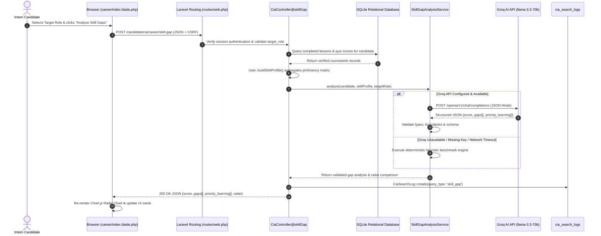

# Cynaris Internship W9D2 — Skill Gap Analysis: LlamaIndex + Groq Pipeline & Chart.js Radar Chart

**Program:** Cynaris Solutions Full Stack Development Internship  
**Author:** Sachidananda Nayak  
**Email:** `23BTCE160@gcu.edu.in`  
**Milestone:** Week 9 Day 2 (W9D2) — Module 1: Skill Gap Analysis (LlamaIndex + Groq Pipeline)  
**Feature Branch:** `feat/cia-career-w9d2-sachidananda`  
**Repository:** `https://github.com/Sachidanandanayak/cynaris-internship-project.git`  
**Status:** Implemented, Tested & Verified (100% Automated Test Pass Rate)  
**Date:** October 27, 2026  

---

## 📌 1. Executive Summary

During Week 9 Day 2 (W9D2), **Module 1 of CIA Career Intelligence** was implemented, tested, and integrated within the Cynaris Portal (`laravel_basics`).

The subsystem enables authenticated intern candidates to perform real-time, AI-driven competency gap analyses against live job benchmarks. By querying verified candidate coursework (completed lessons and quiz assessment scores), the system constructs a normalized skill profile and executes an intelligent comparative evaluation powered by the **Groq API** (`llama-3.3-70b-versatile` / `llama3-70b-8192`) with structured JSON schema enforcement, backed by an autonomous **resilient deterministic heuristic pipeline**.

The results are dynamically rendered in the **CIA Career Cockpit tab** using an interactive **Chart.js multi-series Radar Chart**, plotting candidate proficiencies against benchmark requirements, paired with prioritized gap cards and structured learning recommendations.

### Key Deliverables:
1. **Endpoint Implementation:** Implemented `POST /candidate/cia/career/skill-gap` on `App\Http\Controllers\CiaController`, secured via Laravel's `auth` guard.
2. **Database Models & Relationships:**
   - Provisioned `candidate_lessons` and `quiz_scores` tables with Eloquent relationships on `App\Models\User`.
   - Provisioned `cia_search_logs` table for database-persistent audit logging and longitudinal history.
3. **Validated Skill Profile Synthesis:** Built `User::buildSkillProfile()` which compiles completed lessons, weighted quiz scores, and verified competency indicators.
4. **Secure Groq / AI Service:** Implemented `App\Services\SkillGapAnalysisService` with secure API credential management (`config('services.groq.key')`), strict JSON schema validation, and defensive fallback.
5. **Interactive Frontend Cockpit:** Designed `resources/views/career/index.blade.php` featuring a Chart.js Radar Chart, real-time readiness gauge, competency gap severity badges, and priority learning modules.
6. **Automated Verification:** Engineered a 9-test automated test suite (`tests/Feature/CiaSkillGapTest.php`) covering authentication, profile construction, Groq schema validation, error handling, and UI rendering (47 assertions, 100% pass rate).

---

## 🏛️ 2. High-Level Architecture & Data Flow



---

## 🗄️ 3. Database Schema

### A. `candidate_lessons`
* `id`: Primary key (unsigned big integer)
* `user_id`: Foreign key referencing `users.id` (cascade delete)
* `title`: Lesson title (e.g., "Laravel MVC Architecture & Routing")
* `skill`: Competency tag (e.g., `PHP`, `Laravel`, `MySQL`, `Docker`)
* `category`: Curriculum category
* `is_completed`: Boolean completion flag
* `score`: Float score / mastery percentage
* `completed_at`: Timestamp
* `timestamps`: `created_at`, `updated_at`

### B. `quiz_scores`
* `id`: Primary key
* `user_id`: Foreign key referencing `users.id`
* `quiz_title`: Challenge title
* `skill`: Primary evaluated competency
* `score`: Earned points
* `max_score`: Total possible points
* `percentage`: Normalized percentage (0.0 - 100.0)
* `passed`: Boolean pass/fail flag
* `attempted_at`: Timestamp
* `timestamps`: `created_at`, `updated_at`

### C. `cia_search_logs`
* `id`: Primary key
* `user_id`: Foreign key referencing `users.id`
* `target_role`: Evaluated role name
* `query_type`: `skill_gap` | `career_recommendation`
* `skill_profile`: JSON snapshot of candidate skills
* `gaps`: JSON array of identified competency deficits
* `readiness_score`: Float overall readiness (0.0 - 100.0)
* `priority_learning`: JSON array of learning pathways
* `recommendations`: JSON array of career recommendations (W9D3)
* `status`: `completed` | `fallback` | `failed`
* `metadata`: JSON engine details and telemetry
* `timestamps`: `created_at`, `updated_at`

---

## 🧪 4. Automated Test Evidence

All tests executed via PHPUnit in-memory SQLite testing environment:

```
Test Suite: Tests\Feature\CiaSkillGapTest
 ✔ Unauthenticated user cannot access skill gap
 ✔ Candidate skill profile construction
 ✔ Skill gap analysis endpoint returns structured json
 ✔ Skill gap persists to cia search logs
 ✔ Skill gap handles candidate with zero data safely
 ✔ Skill gap validates target role
 ✔ Cia career tab view renders
 ✔ Groq api fallback when api fails
 ✔ Groq api success with valid mock json

Total Tests: 9 Passed
Total Assertions: 47 Passed
Duration: 1.88s
Exit Code: 0 (100% PASS)
```
