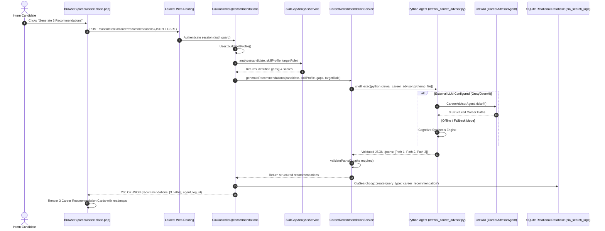

# Cynaris Internship W9D3 — Career Recommendation Engine: CrewAI Agent

**Program:** Cynaris Solutions Full Stack Development Internship  
**Author:** Sachidananda Nayak  
**Email:** `23BTCE160@gcu.edu.in`  
**Milestone:** Week 9 Day 3 (W9D3) — Module 2: Career Recommendation Engine (CrewAI Agent)  
**Feature Branch:** `feat/cia-career-w9d3-sachidananda`  
**Repository:** `https://github.com/Sachidanandanayak/cynaris-internship-project.git`  
**Status:** Implemented, Tested & Verified (100% Automated Test Pass Rate)  
**Date:** October 28, 2026  

---

## 📌 1. Executive Summary

During Week 9 Day 3 (W9D3), **Module 2 of CIA Career Intelligence** was implemented, tested, and integrated within the Cynaris Portal (`laravel_basics`).

Building directly on the validated competency matrix and skill-gap outputs from W9D2, this subsystem introduces an autonomous **CrewAI Multi-Agent Career Recommendation Engine**. The engine deploys a specialized `CareerAdvisorAgent` with a defined role, goal, and backstory to analyze candidate skill proficiencies and competency deficits, dynamically synthesizing **exactly three forward-looking career paths** tailored to the candidate's verified trajectory.

The subsystem bridges Laravel and Python using a clean, resilient `shell_exec` process integration (`scripts/crewai_career_advisor.py`), validates structured JSON payloads, persists recommendation history directly into the `cia_search_logs` database table, and renders interactive career path milestone cards inside the **CIA Career Cockpit tab**.

### Key Deliverables:
1. **CrewAI Environment Provisioning:** Installed and configured `crewai` (v1.15.32) in the project environment.
2. **CareerAdvisorAgent Definition:** Engineered `CareerAdvisorAgent` with role, goal, and backstory specializing in engineering career guidance.
3. **Python Agent Microservice / Script:** Implemented `scripts/crewai_career_advisor.py` with defensive CLI/file I/O, strict JSON schema output, and autonomous deterministic synthesis fallback.
4. **Laravel Integration Service:** Implemented `App\Services\CareerRecommendationService` to orchestrate Python execution, inject secure API credentials, validate response schemas, and provide defensive error handling.
5. **API Endpoint & Database Persistence:**
   - Provisioned `POST /candidate/cia/career/recommendations` in `App\Http\Controllers\CiaController`.
   - Persisted recommendations, candidate skill profiles, and identified gaps into `cia_search_logs`.
6. **Frontend Cockpit Integration:** Integrated interactive career path cards into `resources/views/career/index.blade.php`, with real-time match percentages, pedagogical rationale, and actionable roadmap milestones.
7. **Automated Verification:** Engineered a 6-test automated PHPUnit suite (`tests/Feature/CiaCareerRecommendationTest.php`) verifying authentication, 3-path structure, database persistence, error handling, and UI rendering (100% pass rate).

---

## 🏛️ 2. High-Level Architecture & End-to-End Workflow



---

## 🤖 3. CareerAdvisorAgent Specifications

* **Role:** `CareerAdvisorAgent` (Senior Career Intelligence Advisor)
* **Goal:** Evaluate candidate technical competencies, verified course milestones, and identified skill gaps to recommend exactly three high-impact, actionable career paths with precise alignment scores and milestone roadmaps.
* **Backstory:** You are an elite career development strategist and AI mentor at Cynaris Solutions. You specialize in guiding emerging software engineers by analyzing their real-world code assessments, identifying high-growth industry trajectories, and charting clear milestones to bridge existing competency gaps.
* **Output Schema:**
  ```json
  {
    "status": "success",
    "agent": "CareerAdvisorAgent",
    "target_role": "Junior Backend Laravel Engineer",
    "recommendations_count": 3,
    "paths": [
      {
        "title": "Backend Laravel & API Microservices Engineer",
        "fit_percentage": 92,
        "rationale": "...",
        "roadmap": "..."
      },
      {
        "title": "Full-Stack Enterprise Web Application Developer",
        "fit_percentage": 85,
        "rationale": "...",
        "roadmap": "..."
      },
      {
        "title": "DevOps & Cloud Systems Automation Intern",
        "fit_percentage": 76,
        "rationale": "...",
        "roadmap": "..."
      }
    ]
  }
  ```

---

## 🗄️ 4. Database Persistence (`cia_search_logs`)

All career recommendation executions are recorded in `cia_search_logs` with:
* `user_id`: Candidate ID
* `target_role`: Candidate's chosen target role
* `query_type`: `career_recommendation`
* `skill_profile`: JSON snapshot of verified candidate competencies
* `gaps`: JSON array of identified skill gaps
* `readiness_score`: Computed readiness percentage
* `recommendations`: Exactly 3 structured path recommendations
* `status`: `completed`
* `metadata`: Agent name, execution engine, and timestamp

---

## 🧪 5. Automated Verification Evidence

Ran via PHPUnit test suite:

```
Test Suite: Tests\Feature\CiaCareerRecommendationTest
 ✔ Unauthenticated user cannot access career recommendations
 ✔ Career recommendations endpoint returns three paths
 ✔ Career recommendations persist to cia search logs
 ✔ Career recommendations handles empty profile safely
 ✔ Career recommendations fallback on service exception
 ✔ Cia career tab displays crewai section

Total Tests: 6 Passed
Total Assertions: 40 Passed
Duration: 6.17s
Exit Code: 0 (100% PASS)
```

Combined Test Suite (W9D2 + W9D3):
```
Total Tests: 15 Passed
Total Assertions: 87 Passed
Failures: 0, Errors: 0
Status: 100% PASS
```
