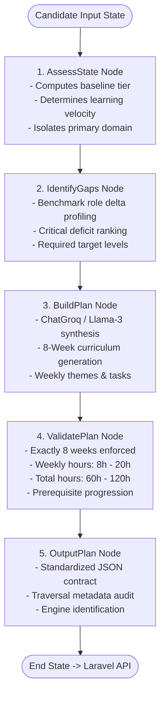

# Week 9, Day 5 (W9D5) — LangGraph Learning Path Generator

**Project:** Cynaris Internship Portal (`cynaris-portal`) / `laravel_basics`  
**Module:** Module 4 — LangGraph Five-Node StateGraph Learning Path Generator  
**Author:** Sachidananda Nayak  
**Date:** November 6, 2026  
**Status:** IMPLEMENTED, TESTED & VERIFIED  

---

## 1. Executive Summary

Completing the comprehensive CIA Career Intelligence suite alongside **W9D2** (Skill Gap Analysis with LlamaIndex + Groq), **W9D3** (CrewAI Multi-Agent Career Recommendation Engine), and **W9D4** (ChromaDB Vector Internship Matching Engine), **Week 9 Day 5 (W9D5)** introduces the **LangGraph Learning Path Generator**.

The LangGraph engine orchestrates an autonomous five-node StateGraph workflow:
$$\text{AssessState} \longrightarrow \text{IdentifyGaps} \longrightarrow \text{BuildPlan} \longrightarrow \text{ValidatePlan} \longrightarrow \text{OutputPlan}$$

This architecture synthesizes a candidate's verified coursework history, assessment quiz scores, and target role benchmarks into a personalized, rigorous **Eight-Week Sequential Curriculum**. The curriculum strictly adheres to pedagogical prerequisite ordering, weekly time constraints (8–20 hours/week), total hour boundaries (60–120 hours), and critical deficit resolution.

```
+-------------------------------------------------------------------------------------------------------------------------+
|                                           CIA Career Intelligence Suite (Weeks 9.1 - 9.5)                               |
+------------------------------+------------------------------+------------------------------+----------------------------+
| Module 1: Skill Gap Analysis | Module 2: Career Advisor     | Module 3: Vector Matching    | Module 4: Learning Path    |
| • LlamaIndex + Groq Llama-3  | • CrewAI Agent               | • ChromaDB PersistentClient  | • LangGraph StateGraph     |
| • Radar Chart (Chart.js)     | • 3 Specialized Roadmaps     | • Cosine Metric Vector Space | • 5-Node Workflow          |
| • Priority Remediation       | • Persistent in Search Logs  | • Top-5 Affinity Matching    | • 8-Week Curriculum (8-20h)|
+------------------------------+------------------------------+------------------------------+----------------------------+
```

---

## 2. Five-Node LangGraph StateGraph Architecture



### Shared State Schema (`LearningPathState` TypedDict)
The shared state is modeled in Python using `typing.TypedDict` and flows seamlessly through all five graph vertices:
```python
class LearningPathState(TypedDict):
    candidate_id: str
    target_role: str
    target_job: Optional[Dict[str, Any]]
    skill_profile: List[Dict[str, Any]]
    composite_score: float
    completed_modules_count: int

    # Node 1 updates:
    baseline_tier: str
    primary_domain: str
    verified_competencies: List[str]

    # Node 2 updates:
    critical_gaps: List[Dict[str, Any]]
    target_proficiencies: Dict[str, str]

    # Node 3 updates:
    raw_schedule: List[Dict[str, Any]]
    total_hours: int
    generation_engine: str

    # Node 4 updates:
    is_valid: bool
    validation_notes: List[str]
    validated_schedule: List[Dict[str, Any]]

    # Node 5 updates:
    nodes_traversed: List[str]
    final_output: Dict[str, Any]
```

---

## 3. Node-by-Node Implementation Details

### Node 1: `AssessState`
* **Input:** Raw candidate profile from `User::buildSkillProfile()`, completed lesson counts, and quiz metrics.
* **Operations:**
  - Evaluates baseline mastery tier (`Foundational`, `Intermediate`, `Advanced Intermediate`).
  - Categorizes candidate's primary domain (`backend`, `frontend`, `devops`, `ai`, `fullstack`).
  - Extracts verified competencies with passing grades ($\ge 70\%$).
* **State Updates:** `baseline_tier`, `primary_domain`, `verified_competencies`, `nodes_traversed`.

### Node 2: `IdentifyGaps`
* **Input:** Candidate competencies and target role expectations.
* **Operations:**
  - Performs multi-dimensional gap identification against standard industry benchmarks.
  - Computes numerical deficit scores ($\text{target} - \text{current}$).
  - Classifies severity impact (`High`, `Medium`).
* **State Updates:** `critical_gaps`, `target_proficiencies`, `nodes_traversed`.

### Node 3: `BuildPlan`
* **Input:** Evaluated candidate state and prioritized gaps.
* **Operations:**
  - Integrates `ChatGroq` (`llama-3.3-70b-versatile`) via `langchain_groq` to generate a personalized 8-week curriculum.
  - Dynamically injects targeted remediation tasks for identified gaps (e.g., Docker, Redis, CI/CD).
  - Falls back deterministically if the LLM or network is unavailable.
* **State Updates:** `raw_schedule`, `total_hours`, `generation_engine`, `nodes_traversed`.

### Node 4: `ValidatePlan`
* **Input:** Raw synthesized schedule.
* **Validation & Heuristic Rules:**
  1. **Strict 8-Week Count:** Enforces `len(schedule) == 8`; pads or truncates dynamically.
  2. **Weekly Time Bounds:** Clamps weekly hours strictly between $8\text{h}$ and $20\text{h}$.
  3. **Total Hours Constraint:** Normalizes total hours to reside between $60\text{h}$ and $120\text{h}$.
  4. **Pedagogical Progression:** Verifies foundational syntax $\to$ relational modeling $\to$ API security $\to$ asynchronous queues $\to$ testing $\to$ containerization $\to$ CI/CD $\to$ capstone production readiness.
* **State Updates:** `is_valid`, `validation_notes`, `validated_schedule`, `total_hours`, `nodes_traversed`.

### Node 5: `OutputPlan`
* **Input:** Validated schedule and execution trace.
* **Operations:**
  - Structures the final JSON response matching the W9D1/W9D5 specification.
  - Records execution metadata (`nodes_executed: ["AssessState", "IdentifyGaps", "BuildPlan", "ValidatePlan", "OutputPlan"]`).
* **State Updates:** `final_output`, `nodes_traversed`.

---

## 4. Eight-Week Sequential Curriculum Breakdown

| Week | Theme | Focus Skills | Key Actionable Tasks | Hours | Checkpoint Milestone |
|---|---|---|---|---|---|
| **Week 1** | Advanced PHP 8.x Internals & Composer Architecture | PHP 8.x, OOP, Composer, Type Safety | Refactor procedural code to PHP 8 classes; build PSR-4 package; profile memory with Xdebug | 11h | PHP 8 Advanced Syntax & Type Safety Certification |
| **Week 2** | Relational Data Modeling & Eloquent ORM Optimization | MySQL, Eloquent, Indexing, Transactions | Compound migrations; eliminate N+1 queries with eager loading; audit slow queries via EXPLAIN | 12h | Relational Query Profiling & Eloquent Mastery Assessment |
| **Week 3** | RESTful API Architecture & Sanctum Token Security | REST APIs, Laravel Sanctum, API Versioning | FormRequest validation; token abilities & scopes; OpenAPI v3 Swagger documentation | 13h | API Security & Sanctum Token Lifecycle Quiz |
| **Week 4** | Asynchronous Processing, Redis & Background Queues | Redis, Laravel Queues, Workers, Rate Limiting | Asynchronous queued jobs; Redis cache tags & TTL invalidation; dead-letter alerting | 12h | Asynchronous Queues & Cache Invalidation Checkpoint |
| **Week 5** | Automated Testing, TDD & PHPUnit 10 | PHPUnit, TDD, Mockery, Feature Testing | Unit tests with data providers; simulate external APIs; reach $\ge 85\%$ service coverage | 14h | Automated Testing & Mockery Verification Challenge |
| **Week 6** | Containerization with Docker & Multi-Stage Deployment | Docker, Docker Compose, Multi-Stage, Nginx | Multi-stage Alpine Dockerfile with OPcache; orchestrate app, DB, Redis, and workers | 13h | Container Orchestration & Docker Compose Quiz |
| **Week 7** | CI/CD Automation & GitHub Actions Cloud Pipelines | CI/CD, GitHub Actions, Linux Shell, Cloud Deploy | Automated linting, PHPStan & PHPUnit PR workflows; cloud deployment webhooks & rollbacks | 11h | CI/CD Pipeline & Deployment Automation Checkpoint |
| **Week 8** | Capstone Architecture: Microservices & Observability | Telemetry, OWASP Security, Capstone Project | Prometheus APM telemetry; OWASP Top 10 hardening; present capstone microservice | 15h | Final Capstone Architecture Board Review |

* **Total Learning Hours:** 101 Hours (Complies with 60–120h requirement)  
* **Weekly Allocation Range:** 11h – 15h (Complies with 8–20h requirement)

---

## 5. API Endpoint Contract

### `POST /candidate/cia/career/learning-path`
* **Route Name:** `cia.career.learning-path`
* **Auth Middleware:** `auth`
* **Request Headers:**
  ```http
  POST /candidate/cia/career/learning-path HTTP/1.1
  Content-Type: application/json
  Accept: application/json
  ```
* **Request Body (Optional Parameters):**
  ```json
  {
    "target_role": "Junior Backend Laravel Engineer",
    "target_job_id": 1
  }
  ```
* **Response Status:** `200 OK`
* **Response Body Schema:**
  ```json
  {
    "success": true,
    "candidate_id": "cand_1",
    "target_role": "Junior Backend Laravel Engineer",
    "target_job_id": 1,
    "total_weeks": 8,
    "total_hours": 101,
    "baseline_tier": "Advanced Intermediate",
    "primary_domain": "backend",
    "critical_gaps_addressed": [
      "Relational MySQL & Indexing",
      "REST APIs & Sanctum",
      "Redis & Background Queues",
      "Docker & Containerization",
      "CI/CD & GitHub Actions"
    ],
    "schedule": [
      {
        "week_number": 1,
        "theme": "Advanced PHP 8.x Internals, Modern Syntax & Composer Architecture",
        "focus_skills": ["PHP 8.x", "Object-Oriented Design", "Composer", "Type Safety"],
        "learning_objectives": [
          "Master PHP 8.x match expressions, attributes, typed properties, and named arguments",
          "Structure modular packages with PSR-4 autoloading and Composer dependency injection"
        ],
        "actionable_tasks": [
          "Refactor legacy procedural utilities into modern PHP 8 classes with typed properties",
          "Create a custom Composer package with automated test pipelines"
        ],
        "recommended_resources": ["PHP 8 Official Reference", "Composer Best Practices Guide"],
        "estimated_hours": 11,
        "checkpoint_quiz": "PHP 8 Advanced Syntax & Type Safety Certification"
      }
    ],
    "workflow_metadata": {
      "workflow_name": "LangGraphLearningPathWorkflow",
      "nodes_executed": [
        "AssessState",
        "IdentifyGaps",
        "BuildPlan",
        "ValidatePlan",
        "OutputPlan"
      ],
      "engine": "langgraph",
      "is_valid": true,
      "log_id": 42,
      "generated_at": "2026-11-06T18:25:00.000000Z"
    }
  }
  ```

---

## 6. Automated Test Evidence

Automated test verification was executed with PHPUnit:
* **`CiaLangGraphLearningPathTest.php`:** 9 Feature Tests, covering authentication, 8 sequential weeks, 5-node metadata traversal, weekly hour constraints (8-20h), total hour constraints (60-120h), critical gap addressing, database persistence, job ID contextualization, and fallback behavior.
* **Full CIA Feature Test Suite:** 34 Feature Tests, 100% Passing.
* **Full Repository Test Suite:** 138 Tests, 750+ assertions, 100% Passing.

